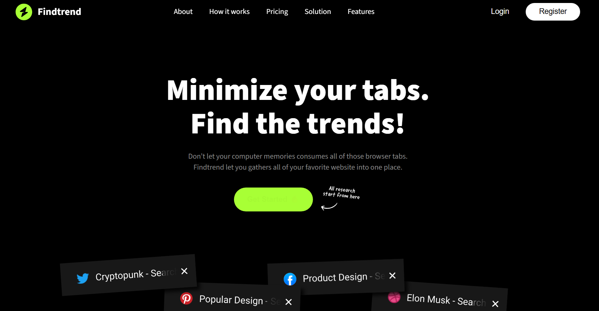

# Findtrend

Findtrend is a single-page frontend project about bringing your favorite websites together.

## Features

- Monthly and yearly pricing views
- Responsive navigation menu
- Login and registration interface

## Run the project

Open `index.html` in your browser.

## Styles

Sass source files are in `assets/css/`. When you save a Sass file, your Sass compiler updates the CSS output used by the page.

## Scope

This is a frontend demo. The login and registration interfaces are not connected to a backend service.