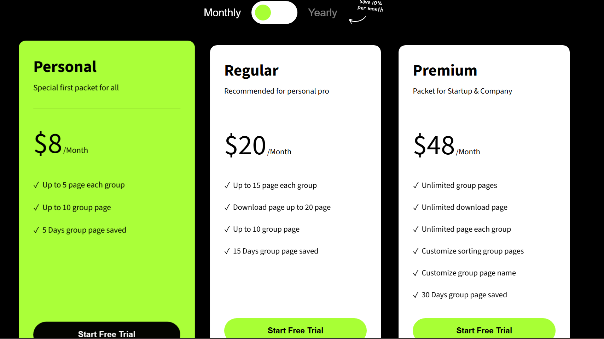
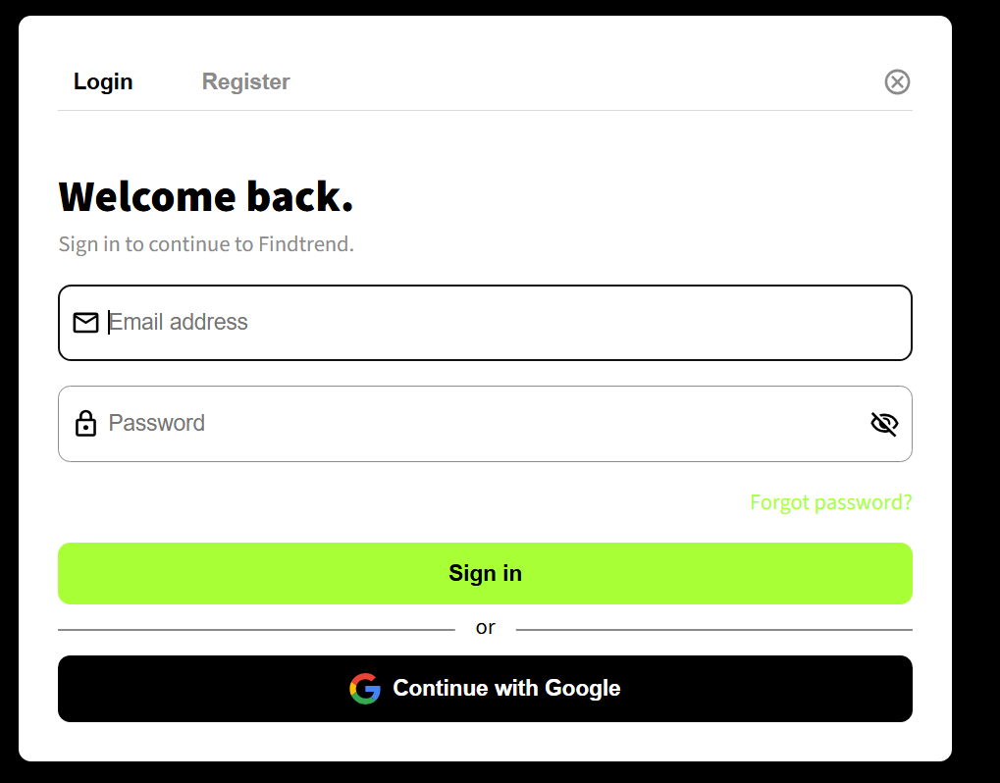
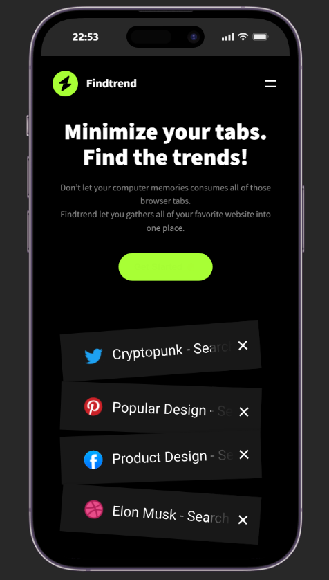
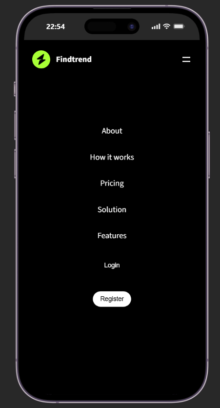
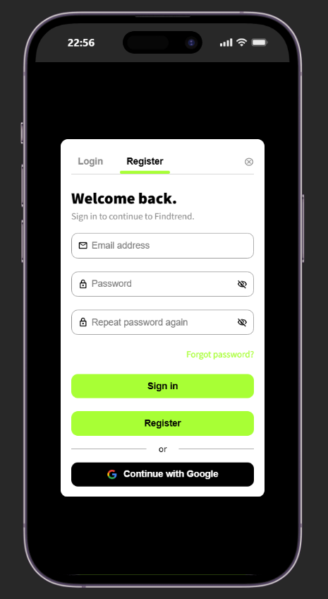

# Findtrend

Findtrend is a single-page frontend project about bringing your favorite websites together.

This is a example modern, responsive trend site. Built using HTML, CSS, SCSS and JavaScript/

## 🌐 Live Demo
👉 [findtrend-sable.vercel.app/](https://findtrend-sable.vercel.app/)

## ✨ Features

- Monthly and yearly pricing views
- Responsive navigation menu
- Login and registration interface

## 🛠️ Technologies Used

- HTML5 (semantic markup)
- SCSS (custom properties, `clamp()`, Flexbox)
- Git & GitHub
- Vanilla JavaScript
- Vercel

### 💻 Desktop Version

    
    
    

### 📱 Mobile Version

    
    
    
    

## Run the project

This project does not require any build tools or dependencies.
Open `index.html` in your browser.

## Styles

Sass source files are in `assets/css/`. When you save a Sass file, your Sass compiler updates the CSS output used by the page.

## Scope

This is a frontend demo. The login and registration interfaces are not connected to a backend service.